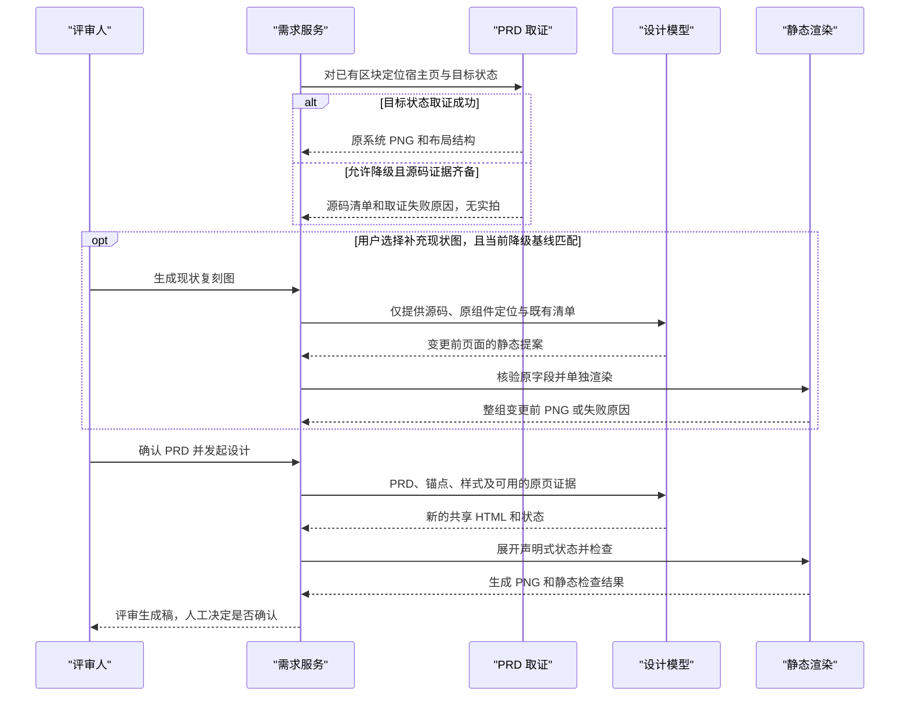

# Core Business Workflows

需求工作区把已确认的业务变更画成可评审的桌面原型。本文只梳理“还原现有页面”这条链路，区分原系统证据、模型生成结果和静态验收结论。

## Domain Entities

| 对象 | 归属 | 对排查还原度的意义 |
| --- | --- | --- |
| 代码快照与 `sourceAnchors` | 项目 / 分析阶段 | 快照是可检索的源材料；锚点指向路由、布局与目标组件，不是渲染后的页面。 |
| `capturePlan` 与 `existingPages` | PRD 修订 | 实拍在 `existingPages`。降级记录取证失败码和既有清单；可按需另存 `sourceFallback.images`，它们是变更前的源码复刻，不是实拍。 |
| `prototypes` 与 `screens` | 设计修订 | 前者是一份共享 HTML/CSS 加声明式状态；后者是平台将各状态展开的 HTML，不是原应用 DOM。 |
| `screenshots` 与 `validation` | 设计修订 / 静态检查 | 生成稿的 PNG 和检查结果，不能反过来充当原系统参考图。 |

## Service-to-Domain Mapping

- [需求服务](../../../../../server/requirements/service.ts)控制生成、确认、重试和修订保存。[需求与设计模型](../../../../../server/requirements/model.ts)负责分类、提取依据和生成提案，不负责确认。
- [区块入口映射](../../../../../server/requirements/capture-mapping.ts)处理宿主页、入口与缺口；[业务页采集](../../../../../server/requirements/page-capture.ts)负责真实取证；[原型渲染](../../../../../server/requirements/artifacts.ts)负责另一套截图。两套截图的对象和用途不同。

## Primary Workflows

### Workflow 1: 从现有页面到增量原型

1. 导入仓库或局部目录为快照。分析阶段从登记资料中提取证据、澄清问题和源码锚点。模型可检索快照，不是直接在原项目上修改组件再启动它。
2. 配置业务预览地址时，PRD 阶段先区分已有调整与独立新增。已有区块追踪到宿主页、具体入口、必要的 Tab / 弹窗步骤和预期字段或内容；独立新增不伪造老页面。[范围、映射与采集编排](../../../../../server/requirements/model.ts#L512)
3. 真实取证成功：保存 1600×1000 首屏 PNG 和页面结构。结构摘要取最多 40 个 `header/nav/aside/main/section/table/form` 的位置、尺寸、文字色、背景色和字体族，不是完整 DOM 或组件设计规格。[实际采样](../../../../../server/requirements/page-capture.ts#L388) 是按批返回的：若某个目标失败并满足源码降级条件，本批已有区块一起转为 `sourceFallback`，不保留同批部分原页图。未配置预览时，有快照的设计仍可走源码样式分支；没有快照时走基于 PRD 的新设计路径，不能宣称在复刻原页。
4. 确认当前 PRD 后才启动整稿设计。设计阶段核对基线指纹，不补拍页面；它另行抽取、核验源码样式。允许 2 至 24 条可核实引文，至少覆盖颜色或字体、以及组件或导航；不要求每个子组件都有尺寸或间距证据。[样式校验](../../../../../server/requirements/design-baseline.ts)证明值确实来自所引文件，并不检查生成 HTML 是否在正确位置用了这些值。已有系统的[本地设计检索](../../../../../server/requirements/model.ts#L187)只补充 UX 和静态布局建议。源码样式不足时，只有完整真实截图和可见结构可代作设计样式基线。
5. 最终模型请求在同一设计会话中结合已确认 PRD、分类、源码锚点、需求映射、核实的样式、现有页面结构，以及实际可用的原页图片附件。已有调整要求 `incremental`，保留外壳与未改区域；新增按 `redesign` 表达。二者都是生成新的静态 HTML/CSS，不是复用原组件实例。[最终请求及字段检查](../../../../../server/requirements/model.ts#L718)
6. 平台解析共享原型，按状态更新节点文本、输入值或显隐，再用禁用页面脚本的 Chrome 生成目标 PNG。源策略、PRD 映射、桌面布局和截图证据均合规后，才能人工确认静态设计；没有原页与生成图的相似度判定。[状态展开](../../../../../server/requirements/prototype-design.ts) · [桌面静态检查](../../../../../server/requirements/artifacts.ts#L227)

### Workflow 2: 检查或调整已有原型

“检查静态设计”重新渲染同一份原型，不请求模型、不会把偏离原页的布局改回来。

指定 `screenId` 并提交修改意见才走[单原型调整](../../../../../server/requirements/prototype-adjustment.ts#L251)。专属会话接收目标共享原型、相关 PRD、分类、锚点及已有原页依据；指纹未变时复用会话上下文，不重复发送相同资料。源码降级时传的是目标区块的字段及内容清单，不会补拍原图。与首次生成不同，微调只开放本地 `ui_ux_search`，不能重新检索原项目源码快照。它仍以共享 HTML 为单位修改，不是只修一张 PNG。

整稿生成和微调遇到规定的静态检查失败，可带候选和每状态错误重试一次。反馈是布局、映射等诊断，不是原图和生成图的对照评审；单纯“不像原页”不会触发重试。

“生成现状复刻图”是[独立的证据作业](../../../../../server/requirements/source-reconstruction.ts)。从最新且匹配的源码降级修订显式发起，不以目标设计 HTML、截图或本期修改意见为输入。平台另行渲染并整组保存变更前 PNG；[系统证据区](../../../../../src/features/requirements/SystemPageEvidence.tsx)按所选修订分别显示实拍与复刻，打开页面或切换修订不触发生成。

## Cross-Service Data Flows

PRD 阶段保存的是按区块组织的原系统依据。设计阶段读取匹配的依据，重新核对样式；有实拍时通过附件传真实图片，无实拍时传源码清单。产物保存后，PRD 插图使用生成 PNG；[设计评审](../../../../../src/features/requirements/DesignReview.tsx#L45)还可能以受限 iframe 显示净化后的 HTML。定位偏差时，应先比对原图与生成 PNG；若只有评审面板不同，再查预览净化、缩放与裁剪。

## Business Workflow Sequence

<!-- mermaid-checked: every participant uses `participant Id as "Label"`, no \n in aliases/messages/notes, every alt/opt/loop closed by end, no `:` inside any alias -->

## Business Rules & Decision Logic

| 排查顺序 | 核对证据 | 能区分的问题 |
| --- | --- | --- |
| 1. 有没有同状态的原图？ | 查看 PRD 修订的 `existingPages`、`capturePlan.sourceFallback.code`、区块及视图。 | 目标未取到、取到另一页或另一业务状态、或有有效参照。生成的 `screenshots` 不算参照。 |
| 2. 模型能复原哪些未改区域？ | 核对宿主和布局锚点、快照中实际存在的样式及组件、设计请求里的 `VERIFIED STYLE BASELINE` 和图片附件。 | 全局样式与目标组件样式不是一回事；引文真实不代表覆盖目标区域、尺寸、间距或排版。 |
| 3. 偏差在生成还是展示？ | 在相同宽度、状态和取景方式下并排比较原页 PNG、生成 PNG、评审预览。 | 前两者不同查生成；生成 PNG 正常而预览不同才查前端。`element` 特写不能直接与整页图比较。 |
| 4. 为什么偏差没报错？ | 静态检查关注可见映射、越界、坏图、空白、裁剪和源安全；已有字段检查是同区块关联 HTML 的文字覆盖。 | 字段出现并不证明所在层级、列宽、按钮位置或控件样式正确；静态通过也不证明业务交互。 |

建议的优化顺序（尚非现有能力）：先用一个代表性状态取得可对齐的原图，同时考虑按区块或视图保留已成功的取证，仅对缺图部分标记源码复刻；再对明确未改的区域记录布局与样式（如侧栏宽、标题位置、行高）；最后只对这些区域做带容差的对照。新增区、动态数据、整页与局部取景应分开处理；无原图时把还原度标为不可判定，不伪造匹配分数。