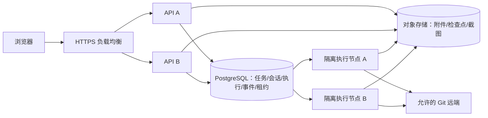

# 多节点任务并行执行方案（暂缓实施）

> 状态：设计方案，尚未实施。当前系统仍是单任务、单机文件存储模式；本轮仅保存方案，方便后续调试完成后再评审实施。不应据此配置两台现有 API 节点直接并行运行。

## 目标与边界

- 正常情况下，至少两台服务器共同提供**全局 5 个实际运行的任务名额**；第 6 个任务可创建并排队，而非收到“请等待当前任务结束”。这里的“运行”指持有执行资源的 Copilot 工作单元，不包括排队或等待推送审批。
- 每个任务同一时刻至多有一个有效执行轮次。同一任务重复请求、跨节点抢占、迟到回调不得造成重复执行或覆盖结果。
- 为编码/构建、浏览器执行分别设资源池与进程级隔离；五个任务同时进入浏览器测试时，若要求仍保持并行，浏览器池也需要五个独立名额。
- 第一阶段针对**两台 API + 至少两台可调度执行节点**的生产部署；不依赖粘性会话、共享可写 Git 目录或本机 JSON 文件。
- 两台节点各提供至少 3 个名额时，正常情况下可达到 5 并行，但一台故障后最多剩 3 个。若要求故障后仍维持 5 并行，则每台都需承载 5 个任务，或增加具备相应容量的执行节点。容量须经实际仓库和浏览器负载压测确定，不能把 3/5 当作 CPU、内存规格。

## 当前阻碍

| 当前行为 | 影响 | 迁移方向 |
| --- | --- | --- |
| `server/index.ts` 和 `src/features/coding/CodingWorkspace.tsx` 用全局非终态任务判断拦截新建和继续 | 等待回答或等待推送也阻塞所有用户 | 改为可排队的统一调度；只在同任务冲突或达到队列上限时拒绝 |
| `server/tasks/store.ts` 用进程内数组和整份 `data/tasks.json` 同步覆盖 | 两个实例会丢写，日志越多写入越重 | 事务数据库保存任务、执行、事件与租约 |
| `server/execution/worker.ts` 的运行集合、问答回调和 `server/index.ts` 的发布集合只在进程内 | 请求换节点或节点故障时丢失协调信息 | 数据库条件转换、执行租约与定向投递 |
| `server/security/auth.ts` 的登录会话/OAuth state 位于内存，回调和跳转地址固定本机 | 负载均衡后登录不稳定，重启后队列失去身份 | HTTPS 公网配置和共享会话/凭据服务 |
| 附件、工作区、截图都在本地 `data/`；diff/发布依赖本地 Git | API 换节点无法读取产物，同一任务可能被两台节点同时写 | 对象存储保存附件、截图、检查点；执行节点独占本地工作区 |
| `server/verification/browser-automation.ts` 只接受本机预览 URL 且每条用例启动 Chrome | 服务器上的 localhost 不是用户电脑，浏览器竞争 CPU/内存 | 隔离的任务预览环境、受限内部地址和浏览器配额 |

## 目标架构

API 无状态，负责鉴权、任务创建、审批与读取结果；执行节点领取任务并在隔离的执行单元中运行 Copilot、构建和测试。API 与执行节点均通过数据库操作任务状态，不能用跨进程共享 JSON 或仅靠内存锁。生产凭据由密钥管理服务注入，访问令牌不得写入任务、日志、检查点或 Git 工作区；工作节点按任务取得最小权限的短期凭据。登录会话与队列作业的授权生命周期应分开设计：会话过期时作业进入 `AUTH_REQUIRED` 等待用户重新授权，不能静默使用失效 token。

## 任务状态与调度

保留现有业务阶段（编码、自测、发布审批等），**另设执行调度状态**：`QUEUED`、`RUNNING`、`WAITING_INPUT`、`WAITING_APPROVAL`、`AUTH_REQUIRED`、`INTERRUPTED`、`DONE`。这样“待审批”不会被误认为占用执行名额，UI 可分别呈现排队位置、所在节点、等待原因及当前阶段；不把这些调度状态直接塞进现有业务 `status`，迁移时需明确兼容映射。

1. 新建任务提交附件后在单个数据库事务内写入任务和排队事件；只有数据库提交成功才返回任务 ID。队列允许多个用户创建任务，并设每用户和全局排队上限以防资源耗尽。
2. 多节点调度器用数据库事务领取任务：锁定候选队列行，验证其预期状态和版本、同任务没有有效执行、全局运行数低于 5、目标节点仍有容量；同时写入唯一 `runId`、节点 ID、租约截止时间和递增的 fencing token。名额分配与领取必须是同一原子操作，不能先数任务再异步启动。
3. 调度采用 FIFO 加每用户公平配额，避免单用户填满五个名额；具体权重与队列上限作为部署配置，经使用情况确定。进程或容器未成功启动时归还名额并记录原因。
4. `NEEDS_INPUT` 保留运行中的 SDK 会话并占一个 Copilot 名额（当前实现依赖进程内等待回调）。用户回答经共享数据库持久化，投递给持有租约的节点；过期、重复回答只能消费一次。只有验证 SDK 可安全挂起并恢复后，才考虑释放该名额。
5. `PUBLISH_PENDING` 已结束编码会话，释放运行名额；刷新、确认与跳过只持有短时**同任务操作锁**。确认或跳过后，生成用例重新排队领取名额，不在 HTTP 请求中直接启动第二个 worker。

所有启动入口（新建、继续编码、补跑自测、发布后继续）共用领取与状态转换 API。请求携带幂等键：同一用户同一任务同一操作的重试返回已有轮次，不产生第二个执行。任务状态、操作种类和版本不匹配时返回冲突和最新任务摘要；前端双击保护只改善体验，不能代替服务端原子约束。

## 写入栅栏与资源隔离

- 每次事件、状态、检查结果、自测证据写入必须验证当前 `runId`、任务版本及有效 fencing token；旧节点租约过期后的迟到回调不能覆盖新轮次。任务事件独立追加并以序号排序，不再每条日志重写整份任务数组。
- 租约通过心跳续期；失效后先停止旧执行单元及其子进程，确认同一工作区没有写入者，才允许由新节点恢复。**数据库栅栏无法阻止已失联进程继续写本地文件或远端 Git**，故障处置需依赖执行单元强制终止、工作区独占和发布前的远端条件校验。
- 每个任务使用独立容器或等效隔离进程树、私有临时 Git 工作区、CPU/内存/PID/磁盘/运行时间配额。构建和测试子进程计入同一配额；节点资源不足时不领取任务。记录队列时长、运行数、CPU/内存峰值、浏览器启动失败和租约失效次数。
- 浏览器池正常容量至少 5，测试浏览器与预览服务按任务隔离；若多个任务必须共享同一可变预览环境/测试账户，则对该环境串行或改为独立实例，不能宣称这部分仍有 5 并行。浏览器仅能访问任务允许的预览地址，需限制内网/元数据访问，不能直接把当前 localhost 校验替换成任意内网 URL。
- 附件及截图采用对象存储的私有对象和按 ownerId 授权的 API 代理或短期签名访问。检查点包含精确 Git HEAD、变更文件、所需未提交内容、附件版本和校验和；不要把可变的网络文件系统当成共享写入的 Git 工作区。

## 发布审批与故障恢复

发布审批记录 `approvalId`、所有者、目标仓库/任务分支、基线 HEAD、文件快照、预期远端提交和已批准动作。审批、跳过和继续执行必须在数据库中做条件转换，两个节点不能同时接受相反操作。发布到已有任务分支仅允许验证后的非强制快进；不得默认提交或推送。

Git push 和数据库写入无法构成一个事务。推送响应超时或节点故障后，先查询远端任务分支：若等于已批准的提交则记为成功；若仍是已批准的前驱提交则允许对**同一次有效审批**重试；若是其他提交则停止并要求人工处理。不得因重新领取队列就自动执行未经审批的 push，也不得在恢复后覆盖被其他人更新的分支。

排队任务在节点故障后可由其他节点领取；进行中的 Copilot 会话默认不可透明迁移。失去租约的任务进入 `INTERRUPTED`，保留最后可靠检查点与日志，核验工作区后由用户明确恢复；重放前识别已完成的外部副作用。`WAITING_APPROVAL` 在重启后仍等待用户操作，不能因为租约过期自动发布。数据库和对象存储分别做备份、访问审计与保留期管理。

## 实施顺序（以后单独批准）

1. **生产基础**：HTTPS/公网 OAuth 配置、共享会话、PostgreSQL schema 和事务化任务/事件存储、对象存储；保持单任务限制，验证两台 API 无粘性会话下读写一致。
2. **安全领取**：统一任务操作与状态转换、幂等键、版本栅栏、租约、同任务独占和双节点故障测试；先限单并发验证，再开启全局 5 名额与公平排队。
3. **执行隔离**：隔离工作单元与子进程资源配额、检查点/恢复、浏览器池及隔离预览服务；移除前后端全局 busy/409 限制，增加排队和资源状态展示。
4. **发布和上线验收**：跨节点发布审批、远端结果对账、压测与故障注入；灰度开启并准备回退开关。回退时停止新的并行领取，保留已运行任务及其审批状态，不能删除工作区或强制重置 Git。

## 验收标准

- 两节点正常时实测五个独立任务**同时处于 RUNNING 并执行 Copilot**，第六个进入队列；调度统计与执行日志一致，实际 CPU/内存不超过配置上限。
- 同任务并发点击继续/自测/确认/跳过，以及两台 API 同时收到请求时，最终只有一个有效操作；旧 `runId` 不能写入新轮次。
- 登录请求跨 API 节点不丢失会话；用户问答能送达正确执行节点；不同 owner 的任务、附件、日志和截图互不可见。
- 人为停止其中一台执行节点后，旧任务无重复 Git 写入/推送，未运行任务由存活节点按剩余容量领取；中断任务显示原因及可恢复检查点。若验收目标是故障后仍五并行，需另行配置足够冗余容量。
- 五个任务同时进入浏览器阶段时不超过浏览器池配额；隔离环境彼此不污染，截图可从任意 API 节点读取；无法隔离的共享预览环境按资源键串行并在 UI 告知等待原因。
- 模拟“推送已成功但响应/数据库写入失败”，远端对账只记录同一次已审批提交，不产生第二个提交、不覆盖远端分支。

## 暂不实施的事项

本文件是后续改造的设计输入，不表示已经支持多任务或多服务器。当前阶段仍保留现有单任务保护，优先解决和调试其他问题。正式实施前需确定部署平台、数据库与对象存储、凭据管理、预览服务运行方式、机器资源规格及单节点故障后的目标容量，并基于目标环境做安全和容量评审。