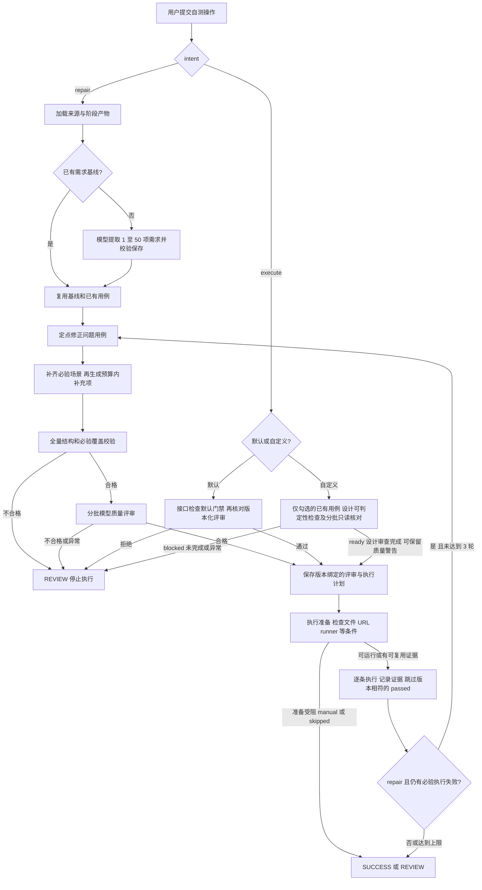

# 当前自测实现链路

执行视角的逐步输入/输出、失败分支、精确 runner 配置、协议数值和能力对照见 [测试执行全流程与约束](test-execution-process.md)。本文侧重生成、评审、短会话和阶段产物。

本文描述已实施的代码：基线提取、用例生成、质量评审与浏览器规划使用独立短会话，阶段输出保存为版本化产物，评审支持逐批检查点恢复。保持超时不自动重发，不改变用户确认的验收范围。

## 入口与会话

- HTTP 入口：`server/index.ts` 的 `POST /api/tasks/:id/self-test`。省略 `intent` 默认 `execute`；`repair` 必须明确提交。
- `execute`：执行已有用例，不生成、补齐或修正用例。默认门禁未通过或还有草稿时，接口直接拒绝；用户明确确认自定义集合时走范围评审。
- `repair`：生成缺失场景、修正明确问题用例，评审合格后执行。仅已结束、可继续处理且工作目录和分支一致的任务可以进入。
- 工作者入口：`server/execution/worker.ts` 的 `execute`。其内部默认意图仍为 `repair`，HTTP 会显式传入意图。发布流程也可调用此入口。
- `server/execution/copilot-session.ts` 的 `openTaskSession` 仅用于编码会话恢复，保留原 ID、`continuePendingWork:false` 和明确授权备用会话保护。
- 自测不恢复、不替换编码会话，也不要求编码会话可用。基线、每次生成批次尝试、每个评审批次、每次浏览器规划分别新建会话，完成或失败均清理连接。生成内容修正重试也使用新会话，完整反馈通过输入传递。
- 每个短会话的 ID、模型、输入指纹及输出保存到 `selfTestArtifacts`，会话目录为 `sessions/<taskId>/self-test/<artifactId>`。恢复依赖持久化产物，而不是 SDK 对话记忆。

## 需求基线与用例生成

主要实现：`server/verification/test-plan-generation.ts`、`test-plan-policy.ts`、`self-test.ts`、`acceptance.ts`。

1. 没有基线时，模型仅依据附件及用户目标返回 1 至 50 项需求，字段包含需求 ID、来源、功能点、验收条件、必验标记和适用场景。解析失败直接停止，不自动重提基线。
2. 确定修正 ID：执行状态异常项、结构不合法项、评审 `caseIssues` 指定项，以及旧 `issues` 中能明确提取的 TC 编号。已通过用例不会因全局评审问题被整体重写。
3. `generateTestBatches` 先分批修正，再补齐必验需求场景，最后生成非必验补充场景。默认每批 8 条、总上限 300 条、补充上限 16 条，可分别配置。
4. 每批提示包含需求基线、已有用例摘要、本批缺项或待修用例、已确认用户决策及明确反馈。每次请求使用独立会话，不累积上一批会话历史。
5. 收到模型结果后保存原始响应和草稿，再解析、合并、检查结构和本批覆盖。成功后保存当前用例集和本批新增/修正产物并清除草稿；已有有效批次保留。未经校验的原始响应标记 blocked，仅用于审计及修正参考，不作为合格产物。
6. 仅解析、结构或覆盖校验失败时，将错误反馈给模型，在当前批次最多尝试 3 次（含首次）。模型发送失败、超时、空结果或保存失败，不进入这段内容修正重试。
7. 达到总上限而必验缺项仍存在时停止并保留已存用例；补充预算不足仅记录未覆盖项，不豁免必验。

## 用例评审

### 视图与逐条状态

生成用例与用例执行为纵向独立模块，无双视图标签：生成模块始终保留设计审核与选择，执行模块只按已保存计划展示选中范围和运行证据，草稿不改写正式范围，不以执行 passed 代替设计合格。SELF_TEST 内区分“正在生成用例”“正在审查用例”“正在核对自定义范围”；`selfTestPlanningStatus` 仍使用 generating / reviewing 等现有值，自定义核对不是新的顶层阶段或生成轮次。

规划页只读取 `acceptanceAssessment.caseReviews` 中显式的 caseId / status（unreviewed / reviewing / qualified / warning / rejected / unknown）。旧记录缺失时为 unknown，不能由聚合 qualified/rejected、issues 未提及编号或运行 passed 推断单条通过。自定义 `executionAssessment` 的已提交范围、设计审查 readiness 及问题独立展示，不覆盖默认评审。ready 显示“设计审查完成”，blocked 显示“设计审查受阻”，executability 显示“设计可判定性”；设计审查与执行准备分开，ready 不代表环境可执行。

### 默认完整评审

1. `assessAcceptance` 先执行确定性检查：字段、映射、场景、断言、前置条件、测试数据、清理方式及必验覆盖。结构拒绝时不会调用模型评审。
2. 结构合格后，将全部用例按批次切分，逐批使用独立只读会话发送完整基线、本批用例、完整用例索引及原始附件。要求依据原文、已确认决策与用例定义核对设计完整性、可判定性、跨用例矛盾和数据清理冲突，返回 `qualified / issues / caseIssues`。不读取测试文件来核对脚本与断言一致性，也不因缺少文件、URL、runner 或实际环境而拒绝设计。基线、输入清单及覆盖矩阵保存为明确产物。
3. `applyQualityReview` 校验 JSON、合格标记与问题列表一致性、问题关联 ID，并累加问题。每批校验后保存结果和部分聚合并等待落库，再开始下一批。拒绝批次仍继续收集后续问题；整轮完成才解除“评审未完成”门禁。输入指纹一致的已完成批次可复用，包括拒绝结果，绝不将拒绝缓存当成通过。
4. 最终拒绝立即进入 REVIEW，等待用户明确发起修正；不会在本次调用中自动反复修到合格。非法评审 JSON、SDK 错误或超时直接退出，没有评审自动重试。

### 自定义范围评审

1. 检查非空集合与理由，仅针对勾选的已有用例调用 `assessExecutionReadiness`；该历史命名函数判定的是设计审查 readiness，不是运行环境就绪。不要求覆盖未选需求场景，不补齐、生成或修复用例。
2. 分批进行独立只读模型核对，返回 `{"findings":[{"code":"问题标识","category":"coverage|quality|executability|conflict|safety","message":"依据","caseIds":["本批用例编号"]}]}`，无问题返回空 findings。默认完整评审仍使用 qualified / issues / caseIssues，严格门禁不变。
3. coverage / quality 仅为警告，包括覆盖缺口、映射或分类不完整、较弱断言；较弱断言仍须有可观察、可判定的结果。设计未说明必要前置条件、测试数据或清理，没有有意义预期或可观察断言、与需求或已确认决策冲突及不安全操作，分别属于 executability（设计可判定性）/ conflict / safety，必须阻断设计审查。缺少实际执行器、文件、URL 或运行环境不是设计阻断依据。
4. 每批保存独立 `executionAssessment` 的部分结果及显式 caseReviews，不覆盖默认 `acceptanceAssessment`。质量 status 与设计审查 readiness 独立，允许 rejected + ready；部分核对保持 checking，整轮完成且 ready 才允许进入执行准备。checking / blocked / unknown 均不能进入执行准备，不以质量 rejected 单独阻断。执行准备产生的 manual/skipped 不更改设计结果。
5. 再次发起执行时，输入未变化的已完成批次复用并继续显示原有问题，包括同一拒绝；失败或中断批次由用户重新发起操作后请求，不自动重放。只有明确 repair 才生成或修正，不因重复 execute 自动反复修到合格。范围或理由变化使范围评审失效。

### 检查点与版本失效

- 生成、默认评审和范围评审均保存检查点，并在进入后续批次前 `flush`。未完成状态始终阻止执行；已发现的问题不会因后续批次超时丢失。
- 评审指纹绑定附件内容、目标、用户决策、完整基线、选中用例定义、代码快照、范围理由、模型与规则版本。运行状态、日志输出和通过证据时间不参与用例定义指纹。
- 相同输入下用户重新发起操作仅发送未完成批次；代码、需求、用例、范围、模型或规则变化时不复用旧结果。现在绑定全量 Git 管理及未忽略文件的内容快照，保守地整轮失效，尚未做细粒度代码影响分析。
- 当前 `selfTestRulesVersion` 为 `isolated-self-test-v3-design-review`；查找完成产物时同时匹配规则版本，旧规则缓存失效，不原地改写历史。规则升级不保证旧任务即时恢复，后续明确操作仍须通过来源、版本和设计核对，再进入执行准备；必要修复仍需用户明确授权。
- 附件或用户决策变化后，execute 阻止使用旧基线；repair 明确提取新基线。评审期间或执行前后代码/来源变化均阻断验收，不允许新版本沿用旧评审。
- 旧基线首次使用时登记为 legacy-import，并重新只读评审；没有版本指纹的历史 passed 证据兼容保留，但日志明确其版本来源无法追溯。新产生的通过证据绑定输入指纹，变化后失效。
- `selfTestPlanningStatus` 是粗粒度状态，详细批次与修订记录以 `selfTestArtifacts` 为准。运行中断的产物不能复用，完成产物保留历史，不原地改写输出。

## 执行与有限修正

- 执行前保存 `testExecutionPlan` 的输入指纹和基线/评审产物引用；默认必验由需求映射决定，自定义必验为用户确认集合。版本相符的 passed 用例不重复执行。
- 文件、URL、runner 和实际环境条件由执行阶段检查或在运行中暴露，不是设计审查门禁。单文件测试只允许受支持框架和仓库内合法独立测试文件；已有测试文件不要求属于本次 Git 变更。脚本运行超时仍为 120 秒，与模型响应超时不是一回事。
- 当前单文件执行准备检查路径、普通文件、大小、受支持脚本等结构条件，检查用例/断言声明及本地 runner 可用性；未支持的脚本参数或组合命令不会被静默忽略，不自动安装或下载依赖。准备受阻记 manual/skipped，不更改设计审查结果，不伪造执行通过。
- 尚无完整脚本语义一致性认证，声明检查不能证明测试脚本实现了用例设计。也没有通用的环境、测试数据或账号自动预检，不承诺自动启动服务、准备业务数据或配置账号。运行环境不足仍可能在实际执行时才暴露，设计 ready 不保证执行成功。
- 浏览器用例若没有可复用脚本，会先以完整用例定义及共享能力契约请求模型生成受限操作 JSON；格式不合法最多反馈修正一次（总共 2 次）。`blocked` 保留为执行准备受阻，记录 reasonCode（capability/environment/authorization/manual/unknown）与可选 requiredCapabilities，不再一律归因为人工；旧响应缺少分类为 unknown，模型发送异常或超时不走格式重试。
- 浏览器协议支持基础键盘、焦点、清空、显隐、启用状态、值、白名单属性及同源 pathname 断言，保留原文本断言。源码中的 browser-v3 parser/runner 另有有界视口、几何、样式、图片/声明字体加载、中心点命中及触发前登记的同源请求计数；最多 60 步且至少一个断言，浏览器总执行预算 120 秒，不含模型规划。并行 worker 协议标记与最终回归待确认，精确契约见全流程文档第 8 节。共享提示/解析及证据指纹包含协议；不能用弱断言替代完整预期。受阻分类与失败阶段保存在运行 JSON 中。敏感交互及文本/值读取运行时拦截，不开放凭据授权、任意 JS 或网络注入。
- 浏览器脚本规划或运行失败按单用例捕获，记入失败集合，继续处理其他用例；同一工作者调用中不会再次生成/执行该失败浏览器项。该行为不等于整个任务在首个模型超时后立刻停止。
- `repair` 外层最多 3 轮：定点修正/补齐、完整质量评审、执行。仅必验执行失败等满足循环条件时可能进入下一轮；质量评审拒绝立即返回，不会消耗剩余轮数继续修正。
- `execute` 不进入修正轮。失败、人工验证、必验项 skipped 或缺少必验项进入 REVIEW；默认 SUCCESS 要求默认设计质量 qualified、至少一条必验、全部必验 passed 和工程检查通过。自定义 SUCCESS 要求已确认非空集合完整设计核对后 readiness=ready，再完成执行准备、全部选中项实际 passed 和工程检查通过；允许范围质量仍 rejected，保留警告及默认拒绝，仅表示范围通过，不是全量验收。符合版本条件的已有通过证据可沿用，历史无指纹证据仍按上述兼容规则明确警告。
- 工程检查在编码阶段按存在的 test/build 脚本执行；独立自测 selfTestOnly 沿用已有 checks，不重新执行工程 test/build。当前判断已有 checks 是否全部通过，不强制项目必须提供这两个脚本。

## 重试边界一览

| 环节 | 当前行为 | SDK 超时后自动重发？ |
| --- | --- | --- |
| 基线提取 | 单次请求，解析失败停止 | 否 |
| 用例生成单批 | 收到不合格内容后最多 3 次内容修正 | 否 |
| 默认/范围质量评审 | 每批独立请求并保存检查点，相同输入复用已完成批次 | 否 |
| 浏览器脚本规划 | 格式错误最多修正 1 次；blocked 不修正 | 否 |
| 测试失败修正 | repair 外层最多 3 轮；浏览器失败集合排除重跑 | 不因超时重放原请求 |
| 会话恢复 | 原 ID，禁止继续待办；特定旧附件格式先备份修复，再重试恢复一次 | 不发送模型请求或重放命令 |

这些是平台代码的边界，不表示 SDK/远端模型服务内部完全没有网络重试机制。平台没有在模型超时后调用发送来重放同一请求。

## 压缩由谁负责

**Copilot SDK 托管的运行时负责会话压缩和截断，不是平台自己实现。**

- SDK 原始事件已有 `session.compaction_start`、`session.compaction_complete`、`session.truncation`。此次平台新增监听只用于显示状态，不调用压缩 API、不改压缩阈值、不删除会话事件。
- 平台 `resumeContext` 是编码恢复的有限历史摘要，不会压缩现有 SDK 会话。独立自测请求通过明确的输入产物和用户决策传递上下文。日志展示/工具输出的长度限制也不等于 SDK 上下文压缩。
- 此次排查的原会话约 34 MB、2616 条持久化事件。2026-10-15 12:02（北京时间）SDK 记录 279561 token、阈值 272000，触发压缩及 BasicTruncator 截断；12:05 结束时仍有 270765 token。这是上下文压力证据，不足以单独证明远端静默的唯一原因。
- 现已引入独立阶段/批次短会话，保留原编码会话和历史；不清空或改写原 SDK 历史，也不保证完全消除远端模型超时。

## 产物契约与权限

此次 caseReviews、findings 和 readiness 沿用现有版本化 JSON 状态、验收快照与产物契约，不新增数据库表或列，不执行 DDL，不提升数据库 schema 版本，不回填或修改真实任务数据。规则版本变更不等同于数据库迁移。

JSON 本地适配器保留任务产物投影；MySQL schema 2 将 `selfTestArtifacts` 保存到 `codeflow_self_test_artifacts`，用例、执行尝试和验收快照分别位于独立表，不再保存为旧任务 payload 的历史数组。V1 非空库不可直接切换，不提供历史回填。每项产物包括 id、revision、schemaVersion、phase、scope、inputFingerprint、inputRefs、status、时间、sessionId、model、rulesVersion、output/error。相同阶段和范围生成新的修订，已完成输出不可覆盖；引用形成基线、生成批次、评审输入清单/覆盖矩阵、批次评审、聚合评审及执行计划的链路。详情/历史投影不代表所有历史已一次加载。

| 阶段 | 明确输入 | 输出 |
| --- | --- | --- |
| 基线 | 原文附件内容版本、用户目标、已确认决策 | 经结构校验的需求基线；歧义通过 ask_user 形成决策，未解决不猜测 |
| 生成 | 基线引用、本批缺项/修正 ID、已有索引、仓库能力、反馈 | 原始响应/草稿、本批合格新增或修正项、获准写入的测试文件路径 |
| 评审 | 基线与原文、用户决策、完整用例定义/索引、覆盖矩阵、范围、规则；代码指纹用于版本绑定，不作为读取测试文件的审查授权 | 每批设计判定及明确用例问题、部分聚合、最终聚合报告 |
| 浏览器规划 | 用例定义、URL、代码版本、来源和评审引用 | 解析通过的受限操作 JSON 或明确 blocked 原因 |

- 基线、评审、浏览器规划只读；生成仅允许仓库内 `.test.*` / `.spec.*`。业务代码、配置、命令、沙箱绕过、越界及符号链接写入拒绝。
- 已有测试文件仅明确修正目标或同批未完成尝试创建的文件可改写，不允许随意覆盖用户或其他用例文件。部分产物保留用于审计，不自动清理用户文件。
- 每个模型请求有独立会话目录，创建 ID 先落库，超时或失败不自动重发。未校验响应不能被当成通过；默认拒绝或未完成评审不能进入默认执行准备，自定义仅在完整设计核对且 readiness=ready 后允许进入执行准备，质量警告仍保留，实际运行条件由执行阶段判定。
- 来源和代码快照不等于实际隔离执行环境。SDK 权限回调与前后版本检查提供约束，不替代操作系统沙箱。Git 忽略的外部依赖和远端服务状态没有完整版本认证，当前结论仍须结合环境前置条件。
- 原文完整性、跨用例业务矛盾主要仍依赖模型和人工决策，独立会话不是独立质量保证；无单独强制基线人工签署页面，也未引入性能专项引擎。

## 存储保留与运维

阶段短会话关闭连接不等于删除 SDK 文件。默认保留已完成、失败、拒绝产物和执行证据，不因缓存失效自动删除历史。worker 已通过 `recordFile` 登记 PRD、设计附件、生成阶段获准写入且仍存在的测试文件，以及浏览器执行返回的截图；普通文件保存 DATA_DIR 相对键、SHA-256、字节数及 displayName / artifactId / caseId 等对应元数据。任务会话目录登记为 `session_manifest`（`directory: true`），覆盖其子孙自测短会话目录，但不逐文件认证 SDK 内容。登记不是全量扫描，不回填历史任务或未经过这些路径的文件。

`npm run db:maintenance -- capacity` 提供只读容量报告，`files --data-dir ...` 只检查文件缺失、危险路径和未登记候选；未登记不等于孤儿，也不代表可以删除。`db:check` 成功文案已为 schema v2，与 API 启动共用九张表的完整预期结构元数据校验，包括字段、InnoDB 基表、索引、同库外键及 RESTRICT 规则、CHECK 名称和启用状态；不比对 CHECK 表达式，也不替代真实写入和约束验证。

`npm run db:maintenance -- delete-task --taskId TASK_ID` 默认 dry-run，须停 API/全部写入者；追加 `--execute` 才清理数据库。仅 core 终态可删，任意活动任务或目标未结束的产物/执行会阻止清理。历史评审、拒绝证据和文件元数据随任务一起删除，但附件、截图、仓库、SDK 目录继续保留；UI 恢复入口会丢失，不会自动导回 SDK 文件。

一致备份须在同一停写窗口覆盖数据库和 uploads/evidence/sessions/workspaces，独立库/目录验证恢复。维护命令不发模型请求、不自动加载环境文件、不删实际 SDK 数据。已提供 `npm run test:mysql-v2` opt-in runner，默认跳过真实库用例；仅使用显式 `CODEFLOW_TEST_DB_*` 专用环境变量，不加载 `.env` 或回退到应用数据库配置。启用后会对唯一、完全空的隔离库执行 DDL、写入、重置及清理，须单独授权；完整变量名、命名限制和风险见 [MySQL 运维手册](mysql-test-database.md)。本次未连接真实 MySQL 或执行启用后的 runner，最小权限及恢复演练仍待隔离验证，不能据代码接入宣告 V2 计划全部完成。

## 此次实施的等待策略

实现入口：`server/execution/model-timeouts.ts`、`session-progress.ts`、`model-turn.ts`。

| 请求类型 | 首次模型或工具响应 | 后续无进展 |
| --- | --- | --- |
| 短评审、基线提取、浏览器脚本规划 | 默认 600000 ms（10 分钟） | 默认 300000 ms（5 分钟） |
| 编码、生成用例 | 默认 1200000 ms（20 分钟） | 默认 1200000 ms（20 分钟） |

- `MODEL_FIRST_RESPONSE_TIMEOUT_MS` 和 `MODEL_INACTIVITY_TIMEOUT_MS` 可分别全局覆盖，允许 10000 至 3600000 的整数；未设置时保留阶段默认值。非法值拒绝发送，不允许无界等待。
- 首响应计时覆盖 SDK 发送 RPC 和首次输出等待；发送确认后显示已接收，回合事件显示已启动。消息/推理流、工具开始/完成/进展才切换到后续窗口并刷新它。
- 上下文压缩开始、完成、失败及截断显示在当前模型请求的“最后活动”；这些状态不当作业务进展续期，也不因压缩而无限暂停。
- ask_user 等待用户回答时暂停，回答后重启当前阶段的等待窗口。超时后解除监听，记录 timed_out，不自动重试或重放命令，最终由工作者清理 SDK 连接。
- 新配置对之后发起的请求生效，修改环境文件需重新加载后台；已开始的请求不动态改变。此次排查未修改真实任务、重启生产 API 或重放命令。